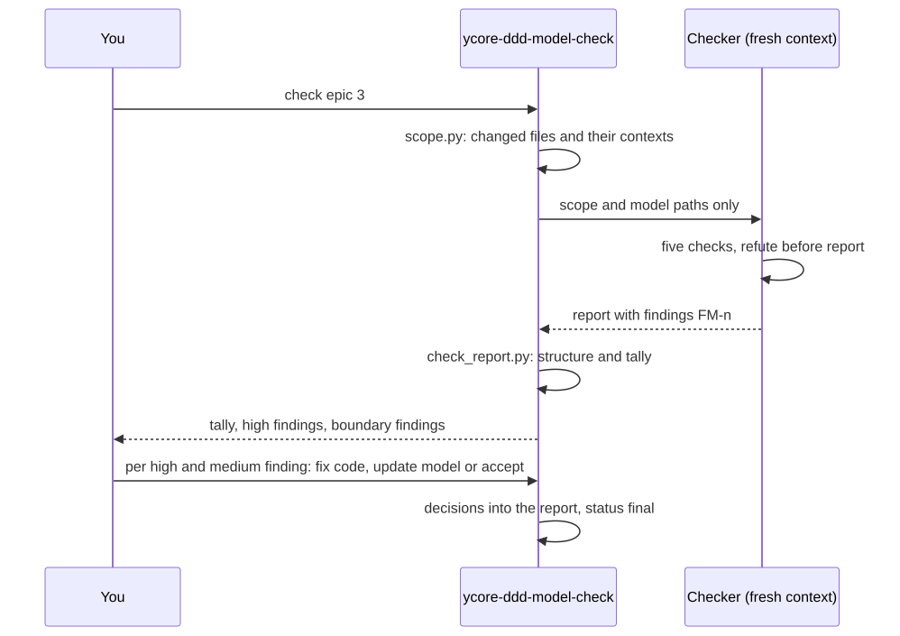

# bmad-ddd-module

[](https://github.com/y-core-engineering/bmad-ddd-module/releases)
[](https://github.com/y-core-engineering/bmad-ddd-module/actions/workflows/tests.yml)
[](LICENSE)
[](https://github.com/bmad-code-org/BMAD-METHOD)
[](https://claude.com/claude-code)
[](https://docs.astral.sh/uv/)

Domain-Driven Design for the BMad Method (BMad Community Module, module code `ycore-ddd`).

BMad elicits requirements thoroughly but does not model the domain: Bounded Context, Context Map, Ubiquitous Language, Event Storming and invariants appear in none of its skills. ycore-ddd adds that step. Its artifacts feed BMad's spec, and its PRD and architecture where the work needs them, and after the build it checks the code against the domain model.

## What a run looks like

A shortened Big Picture run in the Fast path, starting from an idea file:

```text
You:    Run a big picture event storming for docs/idea.md

Claude: What is at stake: a hobby project, an internal tool or a product launch?
You:    A product launch.

Claude: What I understood, in five bullets ... 4 open points, 2 of them block round 1.
        Coaching path (a pause after every round) or Fast path (one final acceptance)?
You:    Fast path.

        [the brief is approved, a team of agents runs six rounds, reviewers check the draft]

Claude: Final acceptance: 3 Hotspots, grouped by scope, context boundaries and language.
        Hotspot 1 of 3, raised by the billing expert in round 5: does a cancelled
        booking still produce an invoice? (a) yes, a cancellation fee (b) no ...
You:    (a)

Claude: Accept the draft? context-map.md, ubiquitous-language.md, event-storming.md
You:    Yes.
```

Every domain question comes to you; the agents decide nothing that changes scope, a context boundary or a term. The same pattern runs per context in the Design Level, and the model check ends with your decision on every high and medium finding.

## Quick start

```bash
npx skills add bmad-code-org/BMAD-METHOD --skill bmad --skill bmod-core-tools -a claude-code
npx skills add y-core-engineering/bmad-ddd-module -a claude-code
claude "bmad setup"
```

Then ask in your own words or call a skill by name. These phrasings started their skill in every run of the [trigger evals](skills/ycore-ddd-big-picture/evals/triggers.json):

| You say | Skill | What happens |
| --- | --- | --- |
| "Run a big picture event storming for docs/idea.md" | `ycore-ddd-big-picture` | interview, brief, six rounds with an agent team, Context Map and glossary |
| "Build the context map and the ubiquitous language for this product" | `ycore-ddd-big-picture` | the same, from a brief or PRFAQ |
| "Design the aggregates for the Billing context" | `ycore-ddd-design-level` | a catalog of the contexts, then seven rounds per context into `design.md` |
| "Welche Invarianten hat der Kontext Inventory, und wer darf welche Commands auslösen?" | `ycore-ddd-design-level` | the same, asked in German |
| "Check epic 3 against the domain model" | `ycore-ddd-model-check` | a fresh-context check of the code, then your decision on every high and medium finding |
| "Bind the model check to the retrospective" | `ycore-ddd-model-check` | `bmad-retrospective` refuses an epic while a high finding is undecided |

The details follow under [Installation](#installation) and [Usage](#usage).

## Origin: part of the Y-Core Method, made public

The Y-Core Method is the delivery method of Y-Core Consulting GmbH. It leads a product from the first idea through domain modelling, architecture and delivery planning to the built and checked epic, with specialised agents for each step. Y-Core Consulting GmbH publishes its domain modelling part as this open module under the MIT licence:

- the Big-Picture Event Storming that finds the Bounded Contexts,
- the Design-Level Event Storming that turns each context into Aggregates, invariants and permissions,
- the domain model check that holds the code against both after the build.

The method is unchanged in substance: one question at a time, nothing guessed, every open domain question a Hotspot that the human decides, and every check run by an agent that has not seen the work it checks. It has been rebuilt as BMad skills so that it works inside BMad's own flow. The other parts of the Y-Core Method, among them idea analysis, competitive analysis, architecture concept, delivery planning and the security check, are not part of this module. If you are interested in the full method, contact Sebastian Herden at [sebastian.herden@ycore.engineering](mailto:sebastian.herden@ycore.engineering).

## Where it fits in BMad



In BMad, `bmad-spec` is the hub: every build reads the spec, and the planning skills exist to give it better material. ycore-ddd adds the domain model to that material. `bmad-prd` and `bmad-architecture` are optional steps between the model and the spec, taken when the work needs them:

| BMad skill | Role | What it takes from ycore-ddd | When to use it |
| --- | --- | --- | --- |
| `bmad-prd` | requirements: users, journeys, functional and non-functional requirements | the glossary for its terms, the Context Map and the Event Storming flow for scope and journeys | requirements need real detail: many stakeholders, compliance, integrations, a product launch |
| `bmad-architecture` | the decisions that keep separately built parts consistent: paradigm, stack, boundaries | the Context Map as the source of the major boundaries, the trust-boundary notes for security, the `design.md` files for what each part must enforce | several people, agents or sessions build parts that must fit together |
| `bmad-spec` | the spec every build reads | everything: the idea, PRD and architecture when they exist, the glossary, Context Map and `design.md` files, and the points passed on under `Open for spec` | always, before the build |

Two connections matter for the model check later. Ask `bmad-architecture` to record a table with the columns `Context` and `Path` that maps each Bounded Context to its folder or module: the model check reads it to assign the code to contexts (or keep the same table as `code-map.md` in the domain model folder). And use the glossary's terms in the spec, so the code's names can be held against the model.

| Skill | What it produces | Typical request |
| --- | --- | --- |
| `ycore-ddd-big-picture` | `context-map.md`, `ubiquitous-language.md`, `event-storming.md` | "big picture event storming", "find the bounded contexts" |
| `ycore-ddd-design-level` | `design-level-catalog.md`, one `<bc-id>-<name>/design.md` per context | "design the aggregates for Ordering", "find the invariants of a bounded context" |
| `ycore-ddd-model-check` | a review report with findings `FM-<n>` and your decision on each; accepted deviations in `accepted-deviations.md` | "check epic 3 against the domain model", "domain model check" |

## Requirements

- BMad 6.13, see [BMad version](#bmad-version) below.
- [uv](https://docs.astral.sh/uv/): every skill runs its own scripts and BMad's shared scripts with `uv run`, and `uv` provides Python 3.11 or later for them.
- Git: the model check takes its scope from commits, and `bmad-build` ends with a commit.
- An agent that can run subagents. The workshops run their expert teams and reviewers as subagents, and the model check runs its checker in a fresh one.

The module is tested with Claude Code. `npx skills add` also installs it for other agents that read Agent Skills, such as OpenCode, Codex or Cursor, but none of them has been tried. Where an agent has no subagents, the skills run the roles one after another in the same context and mark the result as not independent; without a question tool, they ask in plain text.

## Installation

`npx skills add` copies skill folders and nothing else: it does not read the dependencies a module declares. Those are resolved by BMad's own `bmad setup`, so BMad comes first.

1. Install BMad (version 6.13 or later) into the project:

   ```bash
   npx skills add bmad-code-org/BMAD-METHOD --skill bmad --skill bmod-core-tools -a claude-code
   ```

2. Install this module:

   ```bash
   npx skills add y-core-engineering/bmad-ddd-module -a claude-code
   ```

   `-a claude-code` installs for Claude Code. Name your agent instead, or leave the flag out and pick agents interactively; without the agent you work with, its skills folder stays empty.

3. Start your agent in the project and call the `bmad` skill with `setup`. With Claude Code:

   ```bash
   claude "bmad setup"
   ```

   It creates `_bmad/`, asks the questions of every installed module, and checks that the skills a module requires are present. For ycore-ddd it asks:

| Setting | Meaning | Default |
| --- | --- | --- |
| `domain_model_folder` | where the domain model lives | `{project-root}/docs/ddd` |
| `review_folder` | where model check reports go | `{output_folder}/ddd-reviews` |

4. Optional: bind the model check to the retrospective, so that every `bmad-retrospective` reads the check's report for its epic and does not accept an epic with an undecided high finding. It needs `bmad-retrospective` and `bmad-customize`:

   ```bash
   claude "/ycore-ddd-model-check bind the retrospective"
   ```

   The skill writes this as a team override through `bmad-customize`, since a module cannot ship overrides for other skills. If you skip it now, the model check offers it once after its first final report.

A ycore-ddd skill started without BMad says so and points here; the skills never install anything themselves. `bmad setup ycore-ddd` shows and changes the answers later.

Optional: the workshops mention two BMad skills you can call at any point, and customization runs through a third. Install them if you want them:

```bash
npx skills add bmad-code-org/BMAD-METHOD --skill bmad-party-mode --skill bmad-advanced-elicitation --skill bmad-customize -a claude-code
```

### BMad version

ycore-ddd is built and tested against BMad 6.13 (`6.13.0-next` from the BMAD-METHOD repository at the time of writing). It relies on what 6.13 introduced: modules as records with `bmod.toml`, the shared scripts in `_bmad/scripts/`, and a method that builds from `bmad-spec`, `bmad-ticket` and build plans with a `baseline_revision`. Older versions are not supported.

6.13 is not yet a release: the latest release on npm, and the one the `bmad-method` installer sets up, is 6.12.2. Install BMad from the repository as in step 1; `npx skills add bmad-code-org/BMAD-METHOD` takes the current version from its main branch. The module record requires `bmad` 6.13.0-next or later, and `bmad setup` reports when the installed `bmad` is older.

A project set up with BMad 6.12 or earlier (with `epics.md` and `sprint-status.yaml`, or `_bmad/bmm/config.yaml`) needs `claude "bmad migrate method"` before the module is used; the model check finds an epic's files only through the build plans of 6.13. Keep one version per project: BMad skills of an older version installed globally next to 6.13 in the project bring their old steps back, such as an `epics.md`. `claude "bmad status"` shows which modules and versions are installed.

### Updating

`npx skills add` records every installed skill with its source and hash in `skills-lock.json`. Update them from there:

```bash
npx skills update -p             # all project skills, ycore-ddd and BMad alike
npx skills update ycore-ddd-big-picture ycore-ddd-design-level   # only the ones you name
```

Running the install command from step 2 again also works; it overwrites the skill folders with the current version. If the new version brings new settings or requires further skills, run `claude "bmad setup"` afterwards so `_bmad/` catches up.

Then start a new Claude Code session. A running session keeps the skill list it started with and may not see new or renamed skills.

## Usage

### 1. Big Picture: from the idea to the contexts

Start with a product brief, a PRFAQ or any idea description:

```text
Run a big picture event storming for docs/product-brief.md
```

The skill first asks what is at stake (a hobby, an internal tool or a product launch) and scales its depth to the answer. It reads what the project and the environment already tell, then interviews you about the rest, one question at a time, and writes `workshop-brief.md` once you approve it: scope from start to end event, the Domain Expert perspectives, external systems, open points. A team of agents then works through six rounds: Events, timeline, Hotspots, Commands and Policies, Bounded Contexts with Context Map, glossary.

After each round the facilitator sorts the new Hotspots. Domain questions (scope, a context boundary, a term, a protection need) come to you; technical details such as formats or exit codes go on to the spec under `Open for spec`; what the sources already answer, it answers itself. You decide a domain Hotspot, declare it moot, or defer it with an assumption, an owner and a target step. Each question explains itself: what it is about, who raised it and what follows from each answer, with stickies named by their label and the ID only in brackets. Reviewer agents with a fresh context check boundaries, sources and usability before the handover.



In the Coaching path the reviewers check the finished artifacts; in the Fast path they check the draft, and their domain questions join the single final acceptance.

The state lives in the files, so a run can stop after any round and continue in a new session.

### 2. Design Level: from a context to Aggregates and invariants

```text
Run the design level event storming
```

The first run builds a catalog of the contexts with you: which get a full team run and which a short lean note, in which order, with which constraints. Each full run then works one context through seven rounds: Commands with who may issue them, Aggregates, invariants (security-relevant ones marked `❗🔒`), Policies and Read Models, External Systems behind ACLs, abuse cases along STRIDE, synthesis. Domain Hotspots (an Aggregate boundary, an invariant, a permission, a defence) come to you; storage, formats and frameworks go on under `Open for spec`. For a hobby the catalog proposes lean notes. The result is a `design.md` per context in a fixed format that `bmad-spec`, `bmad-architecture` and the model check can read.

### 3. Build with BMad

`bmad-spec` turns the idea and the domain model into the spec that `bmad-build` builds from; for larger work, `bmad-prd` and `bmad-architecture` come first and `bmad-ticket` slices the spec into tickets, as described under [Where it fits in BMad](#where-it-fits-in-bmad). Nothing in ycore-ddd changes how these skills work.

### 4. Model check: does the code still reflect the model?

```text
Check epic 3 against the domain model
```

The check runs in a subagent that has seen nothing of the build, because whoever built the code reads it through the plan. It holds the code against glossary, Context Map and designs in five checks: terms, context boundaries, invariants, coupling between contexts, and domain logic in the code that the model lacks. Every finding names a place in the code and its counterpart in the model. The skill fixes nothing. Afterwards it goes through every high and medium finding with you: fix the code, update the model, or accept the deviation with a reason, which it records so later checks leave it alone. For an epic it takes the changed files from the build plans beside the epic's `tickets.toml` (from the oldest `baseline_revision` to `HEAD`); a `Context`/`Path` table in `code-map.md` or in the architecture document assigns them to contexts, and without one it offers to write `code-map.md` with you. Bound to `bmad-retrospective` (step 4 of the installation), it makes every retrospective read the report and refuse an epic with an undecided high finding.



## Working example

[`examples/hello-world/idea.md`](examples/hello-world/idea.md) is a deliberately small idea to try the module on: a shell program that prints `hello world`. The example takes it from the idea through the domain model to a built and checked MVP, with an optional extension at the end.


The first trial run of this example took the longer path, with a PRD, an architecture spine and epics between the domain model and the build. Its chain, with the domain model in `docs/domain`:



After the build, the model check held the code against the domain model, and the retrospective read its report through the binding described under Usage, which refuses an epic while a high finding is undecided.

### 0. Set up a project

The example needs BMad's method skills for the spec and the build, and a Git repository, since `bmad-build` ends with a commit.

```bash
mkdir hello-world && cd hello-world && git init
mkdir -p docs && curl -fsSL -o docs/idea.md https://raw.githubusercontent.com/y-core-engineering/bmad-ddd-module/main/examples/hello-world/idea.md
npx skills add bmad-code-org/BMAD-METHOD --skill bmad --skill bmod-core-tools --skill bmod-method --skill bmad-spec --skill bmad-build -a claude-code
npx skills add y-core-engineering/bmad-ddd-module -a claude-code
claude "bmad setup"
```

Accept the defaults; the domain model then lands in `docs/ddd`.

### 1. Big Picture: find the contexts

```bash
claude "/ycore-ddd-big-picture docs/idea.md"
```

Answer "hobby" to the stakes question, and choose DDD-lite and the Fast path when asked: the rounds then run without a halt, and you decide the domain Hotspots in one final acceptance. Even this idea raises many questions once a user's and an operator's view meet, for example whether the line ends with a newline, which exit code a closed pipe produces, and whether colour codes may reach a pipe. Most are technical and go on under `Open for spec`; what reaches you are questions such as what "output" and "end" mean to each side. The result is `context-map.md`, `ubiquitous-language.md` and `event-storming.md` in `docs/ddd`.

### 2. Design Level: design the contexts

```bash
claude "/ycore-ddd-design-level"
```

It reads the Big Picture, builds the catalog of contexts with you, and writes a `design.md` per context with Commands, invariants and their sources. The catalog proposes a full team run or a lean note per context; for this idea a lean note is a reasonable choice.

### 3. Spec: what exactly to build

```bash
claude "/bmad-spec create a spec from docs/idea.md and the domain model in docs/ddd"
```

`bmad-spec` condenses the idea and the domain model into the spec that every build reads. Your Hotspot decisions become its requirements, and the points under `Open for spec`, such as the exit code on a closed pipe, are settled here. A larger product would add `bmad-prd` and `bmad-architecture` before this step; for one program built in one session the spec is enough.

### 4. Build the MVP

Start a fresh session for the build:

```bash
claude "/bmad-build build the spec"
```

`bmad-build` plans the work and asks you to approve the plan, implements it with tests, reviews it with an agent and presents a commit. It never pushes. Afterwards the program prints `hello world` when you call it from the shell.

### 5. Model check: does the code match the model?

```bash
claude "/ycore-ddd-model-check codebase"
```

The skill first offers to write `code-map.md`, which assigns the code to the contexts; for one program that is a single row. A checker with a fresh context then holds the code against glossary, Context Map and design and writes a report to `_bmad-output/ddd-reviews/`. Each finding names the place in the code and its counterpart in the model. You decide each high and medium finding: a code fix goes back to `bmad-build`, a model update to the Design Level, an accepted deviation into `docs/ddd/accepted-deviations.md`.

### 6. Optional: extend the MVP

[`examples/hello-world/extension.md`](examples/hello-world/extension.md) lets the program greet by name. The original idea kept parameters out of scope, so the change starts in the model, not in the code:

```bash
curl -fsSL -o docs/extension.md https://raw.githubusercontent.com/y-core-engineering/bmad-ddd-module/main/examples/hello-world/extension.md
claude "/ycore-ddd-big-picture update with docs/extension.md"
claude "/ycore-ddd-design-level update the context the extension touches"
claude "/bmad-spec update the spec with docs/extension.md and the domain model in docs/ddd"
claude "/bmad-build build the spec change"
claude "/ycore-ddd-model-check codebase"
```

The update runs one revision round on the part the extension touches, so the new parameter, its term in the glossary and Hotspots such as an empty name, a name with spaces or a very long one are decided before anyone codes them.

To see what the model check is for, try the shortcut once: build the extension straight from `docs/extension.md` with `bmad-build` and skip the model update. The check then reports the name parameter as domain logic in the code that the model lacks, with its place in the code and where it would have to stand in the model.

## Working modes

Like BMad's own planning skills, the two workshops know three intents:

| Intent | What happens |
| --- | --- |
| create | the default: preparation, rounds, checkpoint, review |
| update | one revision round on a part you name, then checkpoint and review again |
| validate | reviewer agents critique the existing artifacts and write a report; nothing is changed |

They offer two working modes. The Coaching path runs the full interview and pauses after every round to put that round's Hotspots to you. The Fast path drafts the brief or catalog with `[ASSUMPTION]` tags and then runs the rounds, the draft artifacts and the reviewer agents without a halt, up to one final acceptance (in the Design Level one per context) in which you decide every assumption and every Hotspot at once. The Fast path skips pauses, never a decision. Both modes start by asking what is at stake (a hobby, an internal tool or a product launch) and scale their depth to it, read the project and the environment before asking, and put only domain questions to you: technical details the agents raise go on to `bmad-spec` and `bmad-architecture` under `Open for spec`. With Claude Code, Hotspots come as questions with selectable options. Headless, for example in an unattended build loop, the workshops run up to the first point that needs you and stop there; the model check runs completely and returns its result as JSON.

Decisions are kept in memlogs in the domain model folder. Each skill can be customized through `bmad-customize`, for example with additional reviewer lenses (`workflow.finalize_reviewers`) or a closing step (`workflow.on_complete`).

## Continuing an interrupted run

If a workshop session ends early, for example when you cancel it during the final acceptance, nothing that was already logged is lost. You can continue in two ways.

Resume the Claude Code session itself. In the project directory, `claude --continue` reopens the last session and `claude --resume` lets you pick one from a list; in the VS Code extension, open it from the list of past conversations. Then ask it to continue where it stopped.

Or start the skill again with the same input:

```text
/ycore-ddd-big-picture docs/idea.md
```

The workshops route on the files in the domain model folder, not on the conversation. The first line of `board.md` (per context in the Design Level) holds the status: `round <N>`, `checkpoint`, `revision <N>`, `review` or `done`. A resumed `checkpoint` asks only the Hotspots that have no outcome recorded yet, then completes the artifacts that already exist instead of writing them anew. A resumed `review` runs the reviewer gate first. A round folder beyond the last finished round is a round under way; only its missing or empty contributions are assigned again. Your earlier answers are read back from the memlogs (`big-picture.memlog.md`, `design-level.memlog.md`, `<context>/design.memlog.md`).

An answer you gave in the moment before the session ended may not have reached the memlog. That Hotspot is then asked again.

## What lands where

```text
docs/ddd/                          domain_model_folder
├── workshop-brief.md              Big Picture: approved brief
├── big-picture.memlog.md          Big Picture: decisions
├── board.md                       Big Picture: the wall and its status
├── rounds/round-NN/<role>.md      Big Picture: each participant's contribution
├── event-storming.md              Big Picture: flow, subdomains, contexts
├── context-map.md                 Big Picture: Contexts and Edges tables
├── ubiquitous-language.md         Big Picture: glossary per context
├── design-level-catalog.md        Design Level: contexts, depth, order
├── design-level.memlog.md         Design Level: catalog decisions
├── bc01-ordering/
│   ├── board.md, rounds/, design.memlog.md
│   └── design.md                  Design Level: the tactical design
├── code-map.md                    Model check: which path belongs to which context
├── accepted-deviations.md         Model check: deviations you accepted, with reason
└── reviews/                       reviewer gate and validation reports

_bmad-output/ddd-reviews/          review_folder
├── domain-model-review-<slug>.md  Model check: report with findings and decisions
└── .scope-<slug>.json             Model check: the files checked and their contexts
```

## Development

Skills live in `skills/`, one folder each, with the module record in `skills/bmod-ycore-ddd/`. BMad (6.13 or later) with Toolsmith and bmad-eval is installed locally for building and is not part of the repository (`.claude/`, `_bmad/`). To set it up on a new machine:

```bash
npx skills add bmad-code-org/BMAD-METHOD --skill bmad --skill bmod-core-tools --skill bmad-toolsmith --skill bmod-toolsmith --skill bmad-eval -a claude-code -y
```

Then ask the `bmad` skill for `setup`. The scripts in each skill have tests: `uv run python -m unittest discover -s scripts/tests` inside the skill folder.

The diagrams in this README are rendered from their Mermaid sources in `docs/diagrams/*.mmd` to SVG. After changing a source, render it again with the local renderer from the Y-Core tools (`mermaid-render.sh docs/diagrams`) and commit the `.mmd` together with its `.svg`.

## Licence

MIT, see [LICENSE](LICENSE). The licence covers this module. The name Y-Core and the parts of the Y-Core Method not published here are not covered by it.
