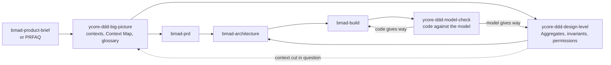
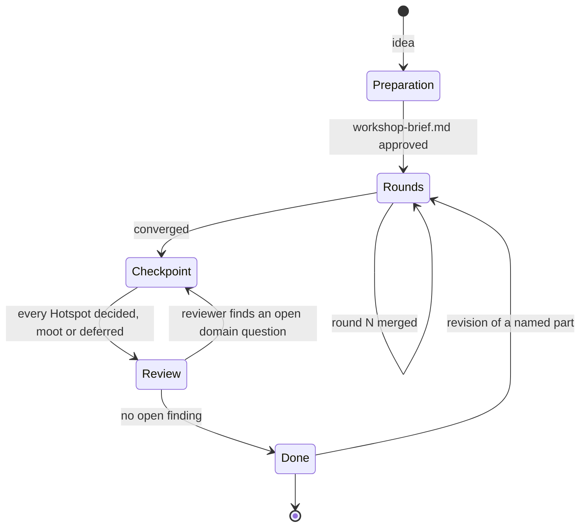
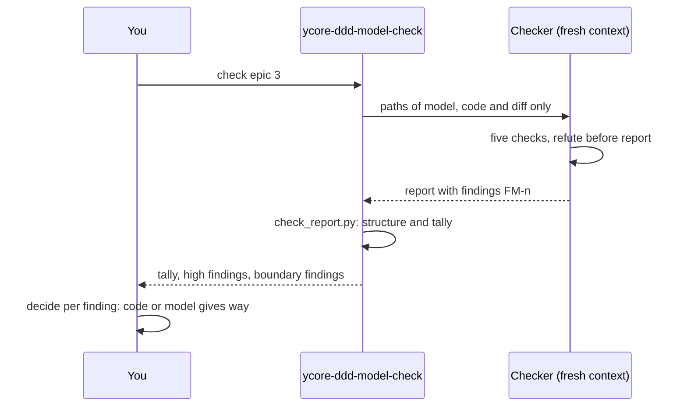

# ycore-ddd

Domain-Driven Design for the BMad Method (BMad Community Module).

BMad elicits requirements thoroughly but does not model the domain: Bounded Context, Context Map, Ubiquitous Language, Event Storming and invariants appear in none of its skills. ycore-ddd adds that step. Its artifacts feed BMad's PRD, architecture and build skills, and after the build it checks the code against the domain model.

## Origin: part of the Y-Core Method, made public

The Y-Core Method is the delivery method of Y-Core Consulting GmbH. It leads a product from the first idea through domain modelling, architecture and delivery planning to the built and checked epic, with specialised agents for each step. Y-Core Consulting GmbH publishes its domain modelling part as this open module under the MIT licence:

- the Big-Picture Event Storming that finds the Bounded Contexts,
- the Design-Level Event Storming that turns each context into Aggregates, invariants and permissions,
- the domain model check that holds the code against both after the build.

The method is unchanged in substance: one question at a time, nothing guessed, every open question a Hotspot that the human decides, and every check run by an agent that has not seen the work it checks. It has been rebuilt as BMad skills so that it works inside BMad's own flow. The other parts of the Y-Core Method, among them idea analysis, competitive analysis, architecture concept, delivery planning and the security check, are not part of this module. If you are interested in the full method, contact Sebastian Herden at [sebastian.herden@ycore.engineering](mailto:sebastian.herden@ycore.engineering).

## Where it fits in BMad



| Skill | What it produces | Typical request |
| --- | --- | --- |
| `ycore-ddd-big-picture` | `context-map.md`, `ubiquitous-language.md`, `event-storming.md` | "big picture event storming", "find the bounded contexts" |
| `ycore-ddd-design-level` | `design-level-catalog.md`, one `<bc-id>-<name>/design.md` per context | "design the aggregates for Ordering", "find the invariants of a bounded context" |
| `ycore-ddd-model-check` | a review report with findings `FM-<n>` | "check epic 3 against the domain model", "domain model check" |

## Installation

The module needs BMad (`bmad`, version 6.13 or later) in the project.

```bash
npx skills add y-core-engineering/ycore-ddd --skill bmod-ycore-ddd --skill ycore-ddd-big-picture --skill ycore-ddd-design-level --skill ycore-ddd-model-check
```

Then ask the `bmad` skill for `setup ycore-ddd`. It asks two questions:

| Setting | Meaning | Default |
| --- | --- | --- |
| `domain_model_folder` | where the domain model lives | `{project-root}/docs/ddd` |
| `review_folder` | where model check reports go | `{output_folder}/ddd-reviews` |

## Usage

### 1. Big Picture: from the idea to the contexts

Start with a product brief, a PRFAQ or any idea description:

```text
Run a big picture event storming for docs/product-brief.md
```

The skill first interviews you about the idea, one question at a time, and writes `workshop-brief.md` once you approve it: scope from start to end event, the Domain Expert perspectives, external systems, open points. A team of agents then works through six rounds: Events, timeline, Hotspots, Commands and Policies, Bounded Contexts with Context Map, glossary. Before anything is final, every Hotspot comes to you, and you decide, declare it moot, or defer it with an assumption, an owner and a target step. Reviewer agents with a fresh context then check boundaries, sources and usability before the handover.



The state lives in the files, so a run can stop after any round and continue in a new session.

### 2. Design Level: from a context to Aggregates and invariants

```text
Run the design level event storming
```

The first run builds a catalog of the contexts with you: which get a full team run and which a short lean note, in which order, with which constraints. Each full run then works one context through seven rounds: Commands with who may issue them, Aggregates, invariants (security-relevant ones marked `❗🔒`), Policies and Read Models, External Systems behind ACLs, abuse cases along STRIDE, synthesis. The result is a `design.md` per context in a fixed format that the architecture and the model check can read.

### 3. Build with BMad

`bmad-prd`, `bmad-architecture` and `bmad-build` take the artifacts as input. Nothing in ycore-ddd changes how they work.

### 4. Model check: does the code still reflect the model?

```text
Check epic 3 against the domain model
```

The check runs in a subagent that has seen nothing of the build, because whoever built the code reads it through the plan. It holds the code against glossary, Context Map and designs in five checks: terms, context boundaries, invariants, coupling between contexts, and domain logic in the code that the model lacks. Every finding names a place in the code and its counterpart in the model. The skill fixes nothing; per finding you decide whether the code or the model gives way.



## Working example

[`examples/hello-world/idea.md`](examples/hello-world/idea.md) is a deliberately small idea to try the module on: a shell program that prints `hello world`. Copy it into a project where BMad and ycore-ddd are installed and start the Big Picture with it:

```bash
mkdir -p <your-project>/docs && cp examples/hello-world/idea.md <your-project>/docs/idea.md
claude "/ycore-ddd-big-picture docs/idea.md"
```

Even this idea yields a surprising number of Hotspots once a user's and an operator's view meet, for example whether the line ends with a newline, which exit code a closed pipe produces, and whether colour codes may reach a pipe.

## Working modes

Like BMad's own planning skills, the two workshops know three intents:

| Intent | What happens |
| --- | --- |
| create | the default: preparation, rounds, checkpoint, review |
| update | one revision round on a part you name, then checkpoint and review again |
| validate | reviewer agents critique the existing artifacts and write a report; nothing is changed |

They offer a Coaching path, the full interview, and a Fast path that drafts the brief or catalog with `[ASSUMPTION]` tags. Every assumption becomes a Hotspot that you decide at the checkpoint, so the Fast path shortens the preparation but skips no decision. Headless, for example in an unattended build loop, the workshops run up to the first point that needs you and stop there; the model check runs completely and returns its result as JSON.

Decisions are kept in memlogs in the domain model folder. Each skill can be customized through `bmad-customize`, for example with additional reviewer lenses (`workflow.finalize_reviewers`) or a closing step (`workflow.on_complete`).

## What lands where

```text
docs/ddd/                          domain_model_folder
├── workshop-brief.md              Big Picture: approved brief
├── big-picture.memlog.md          Big Picture: decisions
├── board.md                       Big Picture: the wall and its status
├── rounds/round-NN/<role>.md      Big Picture: each participant's contribution
├── event-storming.md              Big Picture: flow, subdomains, contexts
├── context-map.md                 Big Picture: Contexts and Edges tables
├── ubiquitous-language.md         Big Picture: glossary per context
├── design-level-catalog.md        Design Level: contexts, depth, order
├── design-level.memlog.md         Design Level: catalog decisions
├── bc01-ordering/
│   ├── board.md, rounds/, design.memlog.md
│   └── design.md                  Design Level: the tactical design
└── reviews/                       reviewer gate and validation reports
```

## Development

Skills live in `skills/`, one folder each, with the module record in `skills/bmod-ycore-ddd/`. BMad v7 with Toolsmith and bmad-eval is installed locally for building and is not part of the repository (`.claude/`, `_bmad/`). To set it up on a new machine:

```bash
npx skills add bmad-code-org/BMAD-METHOD --skill bmad --skill bmod-core-tools --skill bmad-toolsmith --skill bmod-toolsmith --skill bmad-eval -a claude-code -y
```

Then ask the `bmad` skill for `setup`. The scripts in each skill have tests: `uv run python -m unittest discover -s scripts/tests` inside the skill folder.

## Licence

MIT, see [LICENSE](LICENSE). The licence covers this module. The name Y-Core and the parts of the Y-Core Method not published here are not covered by it.
